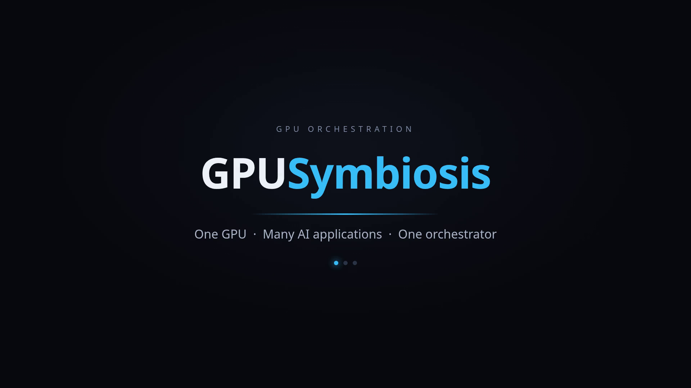

# GPUSymbiosis

> Intelligent coexistence of AI workloads on a shared GPU.

GPUSymbiosis is a local GPU resource orchestration system. It manages a limited GPU
VRAM resource by treating GPU applications as **dynamically resident workloads** rather
than permanently running processes: it monitors running applications, accepts requests
through gateway ports, queues requests when the target application is not resident,
decides which applications should be resident, loads/unloads them, forwards requests,
guarantees that no request is ever interrupted mid-flight, tracks historical demand and
performance, and exposes a web UI for configuration and monitoring.

<br>
[Watch Intro video - https://youtu.be/FZvKfk2nSpw](https://youtu.be/FZvKfk2nSpw)

## Target Workloads

- LLM inference servers (llama.cpp / `llama-server`)
- Ollama
- ComfyUI (image generation)
- TTS (e.g. Breeze TTS)
- Video generation
- AI agent harnesses
- Embedding / reranking servers
- Other GPU workloads

## Features

- **Resource-residency scheduling** — a scheduler that answers "which request
  should be served, which applications should be resident, which resident can
  be evicted" on every tick. Zero-cost resident path, concurrent loading when
  VRAM allows, victim selection with safe **draining** (in-flight requests are
  never interrupted; new requests queue but never hold the drain open), minimum
  residency + switch-margin guards, emergency override, anti-thrash cooldown
  ([06](spec/06-scheduler.md)).
- **Gateway & proxy** — one externally exposed port per gateway; raw-ASGI
  streaming for long responses, SSE and WebSockets; per-gateway queue with
  priority, max-wait and wait-timeout policies; per-gateway API keys; a live
  queue inspector with cancel / force-raise
  ([05](spec/05-gateway-module.md), [12](spec/12-security.md)).
- **Application lifecycle** — two independent state machines (process:
  `STOPPED / STARTING / STARTED / STOPPING / ERROR`; residency:
  `OFF / LOADING / LOADED / UNLOADING`), start/stop/load/unload with per-phase
  timing, dead-process detection, **re-adoption** of processes that survived a
  restart, drain semantics and force-stop
  ([04](spec/04-application-manager.md)).
- **Resource management** — NVML GPU monitoring, per-process VRAM and
  compute-utilisation attribution (rolling window), memory reservations with a
  safety margin, and over-allocation rejection (a manual start/load that
  doesn't fit alongside the residents returns 409)
  ([07](spec/07-resource-manager.md), [14](spec/14-invariants.md)).
- **Idle detection & auto-unload** — a single "active" signal (serving a
  request **or** GPU utilisation ≥ the per-app threshold); idle residents are
  auto-unloaded, with hard exclusions (pinned apps, etc.)
  ([06 §10](spec/06-scheduler.md)).
- **Application types & plugins** — built-in types (`llama`, `ollama`,
  `comfyui`, `tts`, `shell-command`, `custom`, `generic`) and first-class
  drop-in plugins — see [Application-type plugins](#application-type-plugins).
  The `shell-command` type runs a configured command for every POST request via
  a built-in command server ([03 §4](spec/03-application-model.md)).
- **Metrics & history** — 1 s sampling, EWMA demand, latency percentiles,
  per-type metrics declared by a `TypeSpec`, lifetime and per-request metrics,
  retention & aggregation, and a Prometheus endpoint
  (`GET /api/metrics/prometheus`)
  ([08](spec/08-metrics-module.md), [13](spec/13-observability.md)).
- **Web dashboard** — live applications / gateways / requests / event log /
  per-app metrics; sections default to active-only with a per-section
  show-all toggle; independent process and residency badges (a started app
  shows RUNNING when active, STARTED when idle; residency OFF is shown as
  UNLOADED and hidden when load/unload is unsupported); per-gateway scheduler
  score breakdown; live SSE event stream; application and gateway management
  ([11](spec/11-web-ui.md)).
- **REST API** — full admin surface: applications, gateways, requests, events,
  auth, status and metrics ([10](spec/10-api.md)).
- **Security** — loopback bind by default (configurable via the top-level
  `host` field, e.g. `host: 0.0.0.0`; an optional `admin_host` overrides it
  for the admin only), gateway API keys, hashed admin credentials with session
  + CSRF ([12](spec/12-security.md)).
- **Observability** — structured logs, every scheduler decision logged with
  its inputs and outcome, persisted event history
  ([13](spec/13-observability.md)).

## Application-type plugins

A new application type is a **single `.py` file** you drop into
`<data_path>/plugins/` — no config change, no core code change, no build step.
Restart the server and the type is registered; the UI's type dropdown
(`GET /api/application-types`) picks it up automatically, and the user just
selects it for their application. Shipped types and community drop-ins use the
**exact same contract** (spec 04 §8).

A plugin module exposes `register(registry)` — or a module-level
`PLUGIN = TypePlugin(...)` — where a `TypePlugin` pairs a `TypeSpec` (what is
recorded and displayed) with a **handler factory** of the unified signature
`(resources, states, request_metrics, base_urls, session=None,
log_paths=None) -> handler`:

```python
# <data_path>/plugins/mytype.py
from gpusybio.metrics.type_registry import TypePlugin
from gpusybio.metrics.typespec import TypeSpec, MetricDef

SPEC = TypeSpec("mytype", [
    MetricDef(id="tokens", name="Tokens", unit="tok/s", kind="gauge",
              group="throughput"),
])

class MyHandler:
    def __init__(self, resources, states, request_metrics, base_urls,
                 session=None, log_paths=None):
        self.base_urls = base_urls   # app id -> http://127.0.0.1:<port>
        self.log_paths = log_paths   # app id -> log file path

    def collect_metrics(self, app_id):      # required — called each 1 s tick
        return {"tokens": 42.0}             # while the app is STARTED/LOADED

def register(registry):
    registry.register(TypePlugin("mytype", SPEC, MyHandler))
```

What the platform provides for free:

- **Recording & display** — the spec's fields are sampled, aggregated and
  auto-rendered on the metrics card; no dashboard code.
- **Gateway routing** — optional `scheduled_patterns` on the spec decide which
  request paths wake the app vs. pass through
  ([05 §6](spec/05-gateway-module.md)).
- **Request metrics** — optional `get_request_metrics(app_id)` from the
  gateway's request records.
- **Activity interpretation** — optional `detect_activity(app_id)`.
- **Log tailing** — optional `tailer(app_id)` for lifetime metrics from the
  app log (how the `llama` type parses token stats).
- **Fallback safety** — an unknown type falls back to the `generic` handler,
  so an app always works even with a broken or missing type.

Loading at server start: `generic` (unshadowable) → shipped types → drop-ins.
First-registered name wins; each module is exception-isolated — a broken
plugin is logged and skipped, never stops startup.

Community authors should know: single `.py` files only (no packages), imports
limited to what is already installed in the server's venv, a restart is
required after adding, and a plugin executes in the admin process with full
privileges (same trust level as your config and scripts —
[12](spec/12-security.md)).

Full reference, a complete example, and the no-code `custom` type:
[docs/application-type-plugins.md](docs/application-type-plugins.md).

## Specification Modules

This repository holds the functional and technical specification, organised module-wise.

| Doc | Module | Scope |
| --- | --- | --- |
| [01-overview.md](spec/01-overview.md) | Overview & Goals | Problem statement, core example, non-goals |
| [02-architecture.md](spec/02-architecture.md) | Architecture | High-level design, component map, key architectural decision, service layout |
| [03-application-model.md](spec/03-application-model.md) | Application Model | Application fields, types, scripts, memory model & learning |
| [04-application-manager.md](spec/04-application-manager.md) | Application Manager | Lifecycle, process states, timing measurement, handlers/plugins, dead process detection |
| [05-gateway-module.md](spec/05-gateway-module.md) | Gateway & Proxy | Gateway model, queues, proxy behaviour, streaming, request lifecycle & cancellation |
| [06-scheduler.md](spec/06-scheduler.md) | Scheduler | Resource-residency scheduling, scoring, switching algorithm, coexistence, emergency switching, state machine |
| [07-resource-manager.md](spec/07-resource-manager.md) | Resource Manager | GPU/CPU monitoring, NVML, process attribution, reservations, concurrency & locking |
| [08-metrics-module.md](spec/08-metrics-module.md) | Metrics & History | Sampling, EWMA demand, latency percentiles, token metrics, retention policy, event history, extensible type-metrics contract (TypeSpec) |
| [09-data-model.md](spec/09-data-model.md) | Data Model & Database | SQLite schema, tables, retention & aggregation |
| [10-api.md](spec/10-api.md) | REST API | Application, gateway, monitoring, proxy APIs; configuration reference |
| [11-web-ui.md](spec/11-web-ui.md) | Web UI | Dashboard, application & gateway management, scheduler explainer, event log |
| [12-security.md](spec/12-security.md) | Security | Bind addresses, authentication, API keys, script sandboxing |
| [13-observability.md](spec/13-observability.md) | Observability | Structured logs, scheduler decision logging, Prometheus metrics |
| [14-invariants.md](spec/14-invariants.md) | Invariants & Error Handling | Critical invariants, failed-switch recovery, load failure protection, retry policy |
| [15-mvp-phases.md](spec/15-mvp-phases.md) | Delivery Plan | MVP phases 1–5 |
| [16-tech-stack.md](spec/16-tech-stack.md) | Tech Stack (Locked) | Python 3.13 / FastAPI + raw-ASGI proxy / aiohttp / nvidia-ml-py / SQLite + SQLAlchemy / React + ECharts + SSE / systemd |

## Documentation

- [CONTRIBUTING.md](CONTRIBUTING.md) — setup, running, testing, and code conventions
- [Application-type plugins](docs/application-type-plugins.md) — how to add a new
  application type (shipped module or drop-in `plugins/` file) and the `custom` type

## Fundamental Principle

> **GPU applications should be treated as dynamically resident workloads rather than
> permanently running processes.**

## Core Architectural Decision

The scheduler is **not** an "application switcher" — it is a **resource-residency
scheduler**. It answers three independent questions on every evaluation:

1. Which gateway/request should be served?
2. Which applications need to be resident to serve it?
3. Which resident applications can be removed to make room?

This handles multiple gateways pointing at one application **and** multiple
applications coexisting within VRAM, and scales from a 24 GB GPU today to much larger
GPUs later where several LLMs, TTS, and image models remain resident simultaneously.

## Architecture

Everything runs in **one process on one event loop** (spec 16 §3.1) — there is no
multi-worker split and no separate proxy service. The control plane owns the queues,
reservations, and the scheduler lock; the gateway layer is a raw-ASGI pipe in the same
loop; SQLite (WAL) is the source of truth after startup.

```text
   Browser (React + ECharts, built assets served by the API)
        │  REST /api/* (FastAPI)          │  /api/events/sse (SSE)
        ▼                                 ▲
   ┌─────────────────────────────────────────────────────────────┐
   │                     Control plane (1 process)              │
   │                                                             │
   │   Admin API (FastAPI :9530)                                 │
   │   Gateway ports (raw ASGI proxy, one per port) ──┐          │
   │   Scheduler (event-driven + 1 s reconcile)       │          │
   │   Application Manager (start/stop, load/unload)  │          │
   │   Resource Manager (VRAM/CPU attribution)        │          │
   │   State Manager (state machines + invariants)    │          │
   │   Metrics Collector (1 s sampling + aggregator)  │          │
   │   Event bus ─────────────────────────────────────┘          │
   └──────────────────────────────┬──────────────────────────────┘
                                  │  forward (stream / WS / SSE)
                                  ▼
                        ┌──────────────────────┐
                        │   GPU applications   │  (llama, Ollama,
                        │  upstream ports      │   ComfyUI, TTS, …)
                        └──────────────────────┘
                                  ▲
              NVML (nvidia-ml-py)  │  psutil (process tree)
                                  │
                          ┌───────┴────────┐
                          │ GPU + CPU      │
                          └────────────────┘
   Persistence: SQLite (WAL) — config, requests, events, metrics  (spec 09)
```

The key boundaries (spec 02) and where each lives in code:

| Component | Responsibility | Code |
| --- | --- | --- |
| **Gateway / proxy** | Listen on gateway ports; accept, queue, forward, stream, cancel | `gpusybio/gateway/` |
| **Scheduler** | Decide what to serve, what to load, what to evict | `gpusybio/scheduler/` |
| **Application Manager** | Start/stop, load/unload, process + timing measurement | `gpusybio/applications/` |
| **Resource Manager** | VRAM/CPU/temperature, per-app attribution, reservations | `gpusybio/resources/` |
| **State Manager** | Application/gateway/request state machines + invariants | `gpusybio/state/` |
| **Metrics Collector** | 1 s sampling, EWMA demand, latency percentiles, retention | `gpusybio/metrics/` |
| **Admin API** | Configuration + monitoring + SSE | `gpusybio/api/` |
| **Event bus** | Decoupled lifecycle/scheduler events + SSE fan-out | `gpusybio/events/` |

## Implementation — Phase 1 (done)

Phase 1 is implemented per [15 §Phase 1](spec/15-mvp-phases.md) and the definition of
done from [01 §3](spec/01-overview.md#3-core-example) is met end-to-end: A1 resident,
a request to A2's gateway queues, A1 drains and unloads after its request completes,
A2 loads, and the request streams back — enforced by
[tests/test_e2e_core_loop.py](tests/test_e2e_core_loop.py) against real HTTP
endpoints with a fake GPU backend.

### Quick start

```bash
# Python (uv) — run the orchestrator with a config file (see spec/10 §6):
uv run python devrun.py            # dev config with mock GPU apps
# or:  uv run python -m gpusybio.server --config config.yaml

# Listen on all interfaces (default binds 127.0.0.1):
#   in config.yaml add:  host: 0.0.0.0
#   (optional) admin_host: 127.0.0.1   # keep the admin UI loopback-only

# Web UI (optional):
cd web && npm install && npm run build
# the admin API serves the bundle at http://127.0.0.1:9530/
# (dev mode: npm run dev → http://localhost:5173, proxies /api to :9530)

# Tests:
uv run pytest                      # core loop + zero-cost invariants
cd spikes/phase1 && uv run pytest  # tech-stack spikes (7/7)
```

### Layout

```
gpusybio/
  config/        YAML config + pydantic models (spec 10 §6)
  database/      SQLite (WAL) + SQLAlchemy 2.0 (spec 09)
  events/        event bus, structured logging (spec 13), SSE hub (spec 11 §1)
  resources/     GPU backend (NVML / fake) + resource manager (spec 07)
  applications/  process lifecycle + app manager (spec 04)
  gateway/       per-gateway queue + request manager + ASGI proxy (spec 05)
  scheduler/     resource-residency scheduler (spec 06)
  metrics/       sampling + history (spec 08)
  api/           admin REST API (spec 10)
  server.py      composition root: one process, one loop, many listeners (spec 02 §5)
web/             React + TS + Vite + Tailwind + ECharts dashboard (spec 11)
spikes/phase1/   locked-stack spikes: WebSocket proxy, multi-port ASGI, SSE
tests/           E2E core-loop tests + mock GPU app
```

Key Phase 1 behaviours (see the spec for details):

- **Zero-cost resident path** — a request to a resident, idle app is forwarded
  immediately; the scheduler never drains/unloads/reloads an app that is already
  resident ([14](spec/14-invariants.md), invariant 1).
- **Queueing** — requests to a non-resident app wait in the gateway's queue
  `(priority, queued_at)`; full queue → HTTP 429.
- **Safe switching** — an evicted app is only drained when it has no active
  requests; in-flight requests are never interrupted.
- **Gateway-level waiting** — two gateways may point at one app; the second
  gateway's request waits at the gateway even when the app is active
  ([05 §7](spec/05-gateway-module.md)).
- **Structured event log** — every lifecycle/scheduler decision is logged and
  persisted; the dashboard streams it live over SSE.

## Implementation — Phase 2 (done): Intelligent Scheduling

Phase 2 implements the full gateway scoring model
([06 §6](spec/06-scheduler.md#6-gateway-score)) and anti-thrash controls
([06 §16](spec/06-scheduler.md#16-thrashing-prevention)), per
[15 §Phase 2](spec/15-mvp-phases.md#phase-2--intelligent-scheduling--done).

Every scheduler evaluation now scores each queued gateway:

```
gateway_score = priority_pressure + waiting_pressure + recent_demand_pressure
```

with EWMA arrival rate (per gateway) and service rate (per application,
completed requests/min), the demand ratio normalized by `d / (1 + d)`
([06 §6.6](spec/06-scheduler.md)), and a backlog that is the max of the queue
and wait ratios — **allowed to exceed 1** so overdue requests stay urgent
([06 §6.1](spec/06-scheduler.md)). The candidate is the argmax; the decision
then follows the order in
[06 §14](spec/06-scheduler.md#14-decision-order):

1. **Zero-cost resident path** — candidate already resident → activate, no
   switch, no cost.
2. **Concurrent load** — candidate fits alongside residents → load + activate.
3. **Eviction path** — a victim is selected (spec 06 §3); a *busy* victim is
   **drained, not killed**: it is marked DRAINING and the switch completes only
   after its active requests finish ([06 §17](spec/06-scheduler.md)).
   New requests that arrive for a draining app **queue** — they are never
   dropped, and they never cancel or delay the drain ([06 §2](spec/06-scheduler.md)):
   a stream of new requests can't hold the drain open indefinitely, so the
   candidate it exists to serve can't starve. The switch completes the moment
   the draining app's active work is done; the queued request is then served
   when the app is resident again (the scheduler rotates back when its demand
   wins) or it times out per the gateway's wait policy.

Guards and controls:

- **Minimum residency** ([06 §12](spec/06-scheduler.md)) — a young resident
  can't be evicted yet; the switch waits for the window to elapse.
- **Switch margin** ([06 §13](spec/06-scheduler.md)) — the candidate's
  effective score (score − switching cost) must exceed the incumbent's score
  plus a margin before it switches.
- **Emergency override** ([06 §15](spec/06-scheduler.md)) — a very old wait or
  an oversized queue overrides minimum residency, but never the drain.
- **Switch cooldown + bookkeeping** ([06 §16](spec/06-scheduler.md)) —
  re-switching the same pair within the cooldown is suppressed; every switch is
  counted and its pair/previous-application recorded.
- **Process Now** ([06 §9](spec/06-scheduler.md)) — a time-decaying priority
  boost for one gateway; it changes which request is picked next but never
  kills in-flight work.

The scheduler is explained **on the gateways themselves** (spec 11 §5) rather
than in a separate explainer panel — active / candidate / resident apps are
already visible in the Applications section. Each gateway card shows its live
**scheduler score**; hovering the score reveals the breakup (priority, priority /
backlog / waiting / recent-demand pressures, the demand ratio). When that gateway
is the current candidate, the hover also shows the switching penalty, the
effective score (score − penalty) and the decision. The score comes from
`GET /api/status` (`gateways[id].score`); the candidate context and switch
tracking come from `GET /api/scheduler/current-decision`.

**Over-allocation is now rejected.** Admin `start`/`load` enforce Invariant 2
(never exceed the VRAM budget): if an app's required VRAM (incl. safety
margin) doesn't fit alongside the current residents, the transition returns
**409** with `{required_mb, free_mb, residents}`. An already-resident app is
never blocked (the zero-cost path adds no VRAM). This closes the Phase 1 loose
end where a manual `start`/`load` could silently over-commit the GPU.

**All knobs are config-driven** — set them under `settings.scheduler` in
`config.yaml` (defaults shown; omit the section to use them all):

```yaml
settings:
  scheduler:
    interval_ms: 1000              # reconciliation tick
    min_residency_sec: 30          # §12 young-resident guard
    switch_margin: 5               # §13 score margin before a switch
    switch_cost_weight: 1          # §13 switching-cost penalty weight
    emergency_wait_sec: 300        # §15 wait that overrides min residency
    emergency_queue_threshold: null# §15 queue size that overrides min residency
    switch_cooldown_sec: 0         # §16 anti-thrash window for the same pair
    process_now_multiplier: 2      # §9 Process Now priority boost
    process_now_boost_ttl_sec: 120 # §9 boost decay window
    idle_unload_timeout_sec: 300   # §10 idle → auto-unload window
    idle_unload_interval_sec: 5    # §10 idle-detection tick
```

Related knobs: `settings.gpu` (backend, `memory_reserve_mb`,
`memory_safety_margin`), `settings.metrics.interval_sec`, `settings.queue`,
`settings.requests.default_request_timeout_sec`, `settings.load`,
`settings.startup.max_detection_sec`, the top-level `data_path` (global — the
app log at `<data_path>/logs/<id>.log` is the app's stdout; the pid at
`<data_path>/pids/<id>.pid`; scripts see `GPUSYB_DATA_PATH` / `GPUSYB_LOG` /
`GPUSYB_PID_FILE`), and per-application / per-gateway fields
(e.g. `max_concurrent_requests`, `request_timeout_sec`, `wait_timeout_policy`).

**Seed semantics (spec 16 §2.6).** `config.yaml` is a seed: on startup it
**creates missing application/gateway rows only**. An existing DB row is
updated only if that spec sets `update: true`; without the flag, changes made
through the API/UI survive a restart. The seed never deletes rows. Settings are
different — the seed always overwrites them (there is no settings API, so the
YAML is the only way to change a setting).

### Tests

```bash
uv run pytest tests/test_scoring.py                 # scoring model + guards (unit)
uv run pytest tests/test_e2e_core_loop.py           # core loop under the full model
uv run pytest tests/test_scheduling_behavior.py     # residency / margin / emergency / boost / cooldown / 409
```

## Implementation — Phase 3 (done): Metrics

Phase 3 implements the metrics module per
[08](spec/08-metrics-module.md) and
[15 §Phase 3](spec/15-mvp-phases.md#phase-3--metrics--done).

**Sampling & history (08 §1/§6/§7).** A 1-second sampler records GPU (VRAM,
utilization, temperature, power) and per-application (memory, utilization,
active requests) samples to a rolling `MetricSample` table. A background
aggregator rolls raw samples up to 1-minute (kept 30 days) and hourly (kept
indefinitely) `MetricAggregate` rows with min/max/avg/sum, and prunes raw
samples beyond 24 h. Active time is accumulated per application while it is
LOADED — split into *processing* (active requests > 0) and *idle-loaded*
(resident but idle).

**Request & latency metrics (08 §2/§4).** Every request that is received and
completed/failed/cancelled is tracked per application and per gateway:
received/completed/failed counts, queue wait (started − queued) and service
(completed − started) tracked **separately**, average + **P50/P95/P99**
latency percentiles (linear interpolation), arrival rate (received/min) and
service rate (completed/min), and rolling last-1m/5m/15m counts.

**Type-metrics contract (08 §5/§9).** Each application type declares a
**TypeSpec** — a list of `MetricDef`s (id, name, unit, kind, display,
collection source, aggregation). Built-in specs exist for llama/ollama
(token counts, tokens/sec, prompt & generation tok/s, request counts),
ComfyUI, TTS, and a generic fallback that works for every application.
Token metrics for a `llama` application are parsed from the **application log**
(the app's stdout, redirected to `<data_path>/logs/<id>.log` by the start
script): a real `llama-server` has no cumulative token endpoint, but it logs
the per-request token counts and speeds, which the metrics handler tails
(08 §5). Apps with a `/stats` endpoint still work (first non-zero source wins),
and the gateway also records per-request tokens from the upstream response
headers (`X-Input-Tokens` / `X-Output-Tokens`). The metrics API
(`GET /api/applications/{id}/metrics?window=`) returns the live values for the
application's spec plus the common metrics (requests, latency percentiles,
wait/service), and the **Web UI auto-renders the panel from the spec** — so a
new application type renders its metrics without any UI change.

**Endpoints.** `GET /api/applications/{id}/metrics`, `GET
/api/metrics/request` (per-app + per-gateway request metrics), `GET
/api/metrics/summary` (current/avg/max per metric), `GET /api/metrics/history`
(aggregated history for a scope+metric over a window).

### Tests

```bash
uv run pytest tests/test_metrics.py       # request/latency metrics, TypeSpec, handler, aggregator, active time, metrics API
```

## Implementation — Phase 4 (done): Advanced Residency

Phase 4 completes the resource-residency model per
[02 §3](spec/02-architecture.md#3-key-architectural-decision),
[06 §10](spec/06-scheduler.md#10-non-api-applications--idle-unloading) and
[06 §3](spec/06-scheduler.md#3-unload-candidate-selection) — see
[15 §Phase 4](spec/15-mvp-phases.md#phase-4--advanced-residency--done).

**Multi-application residency (coexistence, 02 §3).** When memory allows,
multiple applications are resident simultaneously: the fit check
(06 §7) only evicts a resident when an incoming app does not fit alongside the
current residents. `tests/test_residency.py` boots two 8 GB apps on the 24 GB
fake GPU and asserts both stay LOADED at once, each serving its own gateway.

**Automatic idle detection (06 §10).** A background `IdleUnloader` ticks on a
short interval (default 5 s) and classifies each resident as *active* or
*idle*:

- **API applications** (have a gateway) — active while they have in-flight
  requests; idle when `active_requests == 0`.
- **Non-API applications** (e.g. ComfyUI) — tracked via GPU utilization; active
  while `process GPU% ≥ idle threshold` (default 5 %, per-app override),
  idle below it.

**Automatic unloading (06 §10).** When a resident has been idle longer than its
idle timeout (default 300 s, per-app override), it is auto-unloaded — subject
to the same hard exclusions as the eviction path (06 §3.1): never while
`active_requests > 0`, never when `allow_automatic_unload` is false, never when
pinned (automatic path), plus a minimum-residency guard and a pending-demand
suppression (queued requests or recent arrivals). The unload publishes an
`IDLE_TIMEOUT` event then drives the normal unload lifecycle (so a subsequent
request reloads and serves it).

**Unload is driven by the unload script.** An app is *unloadable* iff it has an
**unload script** — the process stays up and the model is released (fast,
re-loadable). The **load script is optional**: if it is absent, an unloaded app
resumes serving immediately (no load step). An app with no unload script cannot
be unloaded (the process *is* the model), so it is **stopped directly** (kill
the process). The "release VRAM" step used by both the idle unloader and the
eviction path routes through `ApplicationManager.release()`: it **unloads**
apps that have an unload script and **stops** the rest. In the UI, an unloadable
app offers both an **Unload** and a **Stop** button (Stop is the direct-kill
path, always available); a non-unloadable app offers only **Stop**. The manual
`POST /api/applications/{id}/unload` is rejected (400) for apps without an
unload script — stop it instead. Load/unload only work for a **started**
(running) app.

**Application retention scoring (06 §3).** Unload-candidate selection scores
residents by `unload_score = idle_pressure + low_demand_pressure +
low_priority_pressure + residency_pressure − unload_cost` and evicts the lowest
retention value first (implemented in the scheduler; see Phase 2).

**Endpoints & config.** `GET /api/idle/status` reports per-app
`active`/`idle_for_sec`/`method`/`auto_unloadable`/`reason`. New scheduler
knobs: `idle_unload_timeout_sec` (default 300 s) and
`idle_unload_interval_sec` (default 5 s); per-app `idle_unload_timeout_sec`,
`activity_detection_method`, `idle_threshold_gpu_pct`.

### Tests

```bash
uv run pytest tests/test_idle.py         # idle detection (API + non-API GPU), exclusions, min-residency, pending demand, auto-unload + re-serve, idle-status API
uv run pytest tests/test_residency.py    # two-app coexistence, both resident + both served
```

## Implementation — Phase 5 (MVP, done)

Phase 5 delivers the remaining MVP features per
[15 §Phase 5](spec/15-mvp-phases.md#phase-5-mvp--done).

**Gateway API keys (12 §2).** Per-gateway `Authorization: Bearer <key>` is
checked before queueing — an invalid key is rejected with 401 and never
enqueued. Keys are managed via `POST/GET /api/gateways/{id}/keys` and
`DELETE /api/gateways/{id}/keys/{key_id}` (only a prefix + created-at are
returned; hashes are stored). Auth is optional in development — a gateway with
no keys allows all requests. Covered by `tests/test_auth.py`.

**Admin authentication (12 §3).** Local admin accounts with salted scrypt
hashing (`scrypt$<salt>$<hash>`, n=16384 r=8 p=1), session-based auth via an
httpOnly SameSite=Strict cookie, and CSRF protection (double-submit token) on
state-changing endpoints. Destructive actions (Force Stop, Delete, Clear Queue)
require explicit confirmation (`confirm=true`) and are audited in the event log
with the acting identity (12 §5). Auth is optional in development — the admin
API is open until the first admin exists. Endpoints:
`POST /api/auth/admins` (bootstrap), `POST /api/auth/login`,
`POST /api/auth/logout`, `GET /api/auth/me`, `GET /api/auth/admins`,
`DELETE /api/auth/admins/{id}`. Covered by `tests/test_admin_auth.py`.

**Request cancellation (05 §6.3).** `POST /api/requests/{id}/cancel` (202)
cancels a queued or in-flight request. The proxy wakes the client and returns
409 "request cancelled" when the request reaches a terminal state (no orphan
queued requests, no hung clients). Covered by `tests/test_phase5_misc.py`.

**Pinned applications (06 §3.1).** Pinned apps are excluded from automatic idle
unloading and eviction: `POST /api/applications/{id}/pin` and
`DELETE /api/applications/{id}/pin`. Covered by `tests/test_phase5_misc.py`.

**Load-failure recovery (06 §9).** Repeated load failures trip a faulted
back-off (`faulted_until`), so a failing app is not retried while faulted; the
fault is surfaced in the application status and clearing it re-enables loading.
Covered by `tests/test_phase5_misc.py`.

**WebSocket + streaming hardening.** The gateway proxies WebSocket traffic to
the application (`ws://` → app `/ws`), and concurrent multi-application
streaming keeps each client's stream isolated (no cross-talk between apps).
Covered by `tests/test_phase5_streaming.py`.

**Scheduler simulation (what-if).** `POST /api/scheduler/simulate` runs the
scoring model against the current state *without acting* — it reports the
decision and scores it would make and doubles as an integration harness
(16). Covered by `tests/test_phase5_simulate.py`.

### Tests

```bash
uv run pytest tests/test_auth.py              # gateway API keys (auth optional in dev)
uv run pytest tests/test_admin_auth.py        # admin auth: scrypt, sessions, CSRF, confirmation, dev-mode open
uv run pytest tests/test_phase5_misc.py       # request cancellation, pinned apps, load-failure recovery
uv run pytest tests/test_phase5_streaming.py  # WebSocket proxy + concurrent multi-app streaming
uv run pytest tests/test_phase5_simulate.py   # scheduler simulation (what-if, no action)
```

## Implementation — Management UI (done)

The Web UI now implements the management surface per
[11 §2–§4](spec/11-web-ui.md#2-application-management-ui): the single-page
dashboard is organised into three tabs — **Dashboard** (the existing live
view), **Applications**, and **Gateways** — and the API is fully manageable
from the UI.

**Application management (11 §2).** The Applications tab lists all
applications as cards with state-dependent actions (Start/Unload/Force
Stop, Pin/Unpin) plus **Edit** and **Delete**. Create and edit use the same
form, with the sections from [11 §2.3](spec/11-web-ui.md#23-add--edit-application):
General (id, name, description, type), Process (name, start/stop scripts),
Loading (load/unload scripts, auto-unload, idle timeout, activity detection,
idle threshold), Network (port, protocol, health/ready check), Resource
(GPU/CPU memory, safety margin), and a read-only Timing section. Editing is
pre-filled from the current configuration; deleting is a confirmed destructive
action (spec 12 §5) that removes the application's gateways and request
history.

**Gateway management (11 §3).** The Gateways tab lists gateways as cards
with **Process Now**, **Disable/Enable**, **Edit**, **Delete**, plus
**Keys** and **Queue** panels. Create and edit use the gateway form
(routing: name, port, application, priority, enabled; queueing: max waiting
queue, max wait time, wait-timeout policy, request timeout, max concurrent
requests). Creating a gateway — and changing its port — brings up a live
listener for that gateway immediately (the scheduler sees it via the request
manager), and deleting one tears the listener down. Port conflicts and
unknown applications are rejected with clear errors.

**Queued Request Inspector (11 §4).** Each gateway card opens a live queue
inspector (2 s polling): every queued request shows its id, priority, wait
time, received time, and client metadata, with two actions — **Cancel**
(queued only, confirmed) and **Force** (raises the request to the top of the
queue; it is served next but never kills in-flight work, per
[06 §9](spec/06-scheduler.md#9-priority-boost)).

**API keys (12 §2).** Each gateway's **Keys** panel creates, lists, and
deletes gateway API keys. A newly created key is shown in full exactly once
("copy it now"); afterwards only the name and creation time are visible.

**Auth (12 §3).** When no admin is configured the UI runs in open dev mode
and skips the login screen. Once an admin exists, a login panel gates the
UI: it authenticates via `POST /api/auth/login`, carries the session cookie,
and attaches the double-submit CSRF token to every state-changing call.

Covered by `tests/test_admin_ui.py` (queue inspector, live gateway lifecycle,
application CRUD round-trip, auth + CSRF endpoints).
